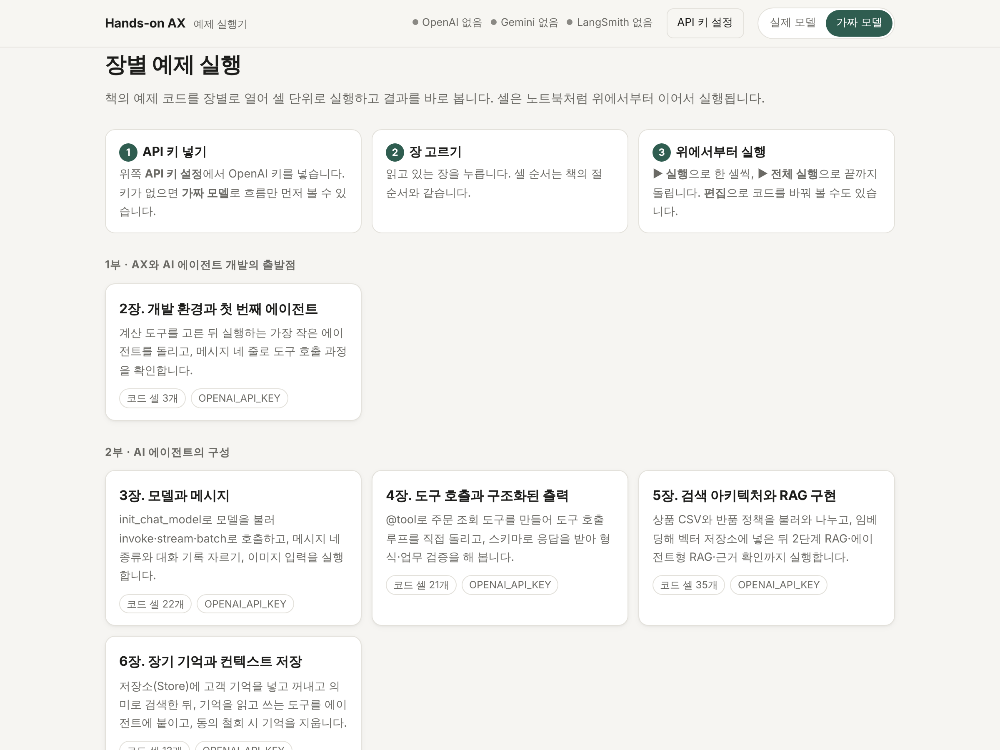

# 『Hands-on AX』 예제 실행기

책의 예제 코드를 장별로 열어 셀 단위로 실행하고 결과를 바로 보는 프로그램입니다.
내 컴퓨터에서 작은 서버를 띄우고 브라우저로 접속해 씁니다. 노트북 프로그램을 따로 설치하지 않아도 됩니다.



## 준비물

- 파이썬 3.11 이상 (3.12 권장) — <https://www.python.org/downloads/>
  - Windows에서 설치할 때 **Add python.exe to PATH**에 체크합니다.
- OpenAI API 키 (2~18장) — <https://platform.openai.com/api-keys>
- 키가 없어도 **가짜 모델** 모드로 실행 흐름은 볼 수 있습니다.

## 내려받기

<https://github.com/dsjasonkim-png/hands-on-AX>에서 **Code → Download ZIP**으로 받아 압축을 풀거나, git으로 받습니다.

```bash
git clone https://github.com/dsjasonkim-png/hands-on-AX.git
cd hands-on-AX
```

## 실행

| 운영체제 | 방법 |
|---|---|
| Windows | 폴더의 `run_book_runner.bat`을 두 번 누릅니다. |
| macOS | `run_book_runner.command`를 두 번 누릅니다. 처음에 "확인되지 않은 개발자" 경고가 뜨면 파일을 **오른쪽 버튼 → 열기**로 엽니다. |
| Linux | 터미널에서 `./run_book_runner.command`를 실행합니다. |

처음 한 번은 가상 환경(`.venv_runner`)을 만들고 패키지를 설치하느라 5~15분쯤 걸립니다. 실행 창에 받는 패키지와 경과 시간이 표시되고, 오래 조용한 단계에서도 15초마다 아직 작업 중이라고 알려 줍니다. 그다음부터는 바로 뜹니다.
서버가 뜨면 브라우저에서 `http://127.0.0.1:8765`가 열립니다. 끝낼 때는 실행 창에서 `Ctrl+C`를 누르거나 창을 닫습니다.

## 사용법

1. 위쪽 **API 키 설정**에서 키를 넣습니다. 키는 이 폴더의 `.env` 파일에만 저장되고 화면에 다시 보이지 않습니다.
2. 장 목록에서 읽고 있는 장을 누릅니다.
3. **▶ 실행**으로 셀을 하나씩, **▶ 전체 실행**으로 끝까지 실행합니다. 노트북처럼 앞 셀에서 만든 변수를 뒤 셀이 이어서 씁니다.
4. **편집**을 누르면 코드를 고쳐서 실행해 볼 수 있습니다. 원래 코드는 페이지를 새로 고치면 돌아옵니다.

셀 위의 표시는 다음 뜻입니다.

| 표시 | 뜻 |
|---|---|
| 원고 | 책에 실린 코드 그대로입니다. |
| 실행용 보조 | 책 본문에는 없지만 실행하려면 필요한 준비 코드입니다(앞 장에서 만든 도구, 예시 주소 대신 쓸 로컬 서버 등). |
| 읽기 전용 | 책에 실렸지만 그대로는 실행되지 않는 코드입니다(예시 주소, 다른 회사 키가 필요한 코드 등). 바로 아래에 실행할 수 있는 보조 셀이 있습니다. |

**모델 모드**

- **실제 모델:** 저장한 API 키로 실제 모델을 부릅니다. 사용량만큼 요금이 나갑니다.
- **가짜 모델:** 키 없이 흐름만 확인하는 연습 모드입니다. 답 문장은 `[가짜 모델]`로 시작하는 예시이고, 실제 모델의 답과 다릅니다.

## 자주 묻는 것

- **브라우저가 열리지 않아요.** 실행 창에 나온 주소(`http://127.0.0.1:8765` 등)를 직접 열어 보세요. 8765번 포트가 쓰이고 있으면 다음 번호로 자동으로 바꿉니다.
- **패키지 설치가 실패해요.** 회사 네트워크에서 PyPI 접속이 막혀 있을 수 있습니다. `logs/install.log`의 마지막 부분에 원인이 남습니다. 중간에 창을 닫았다면 실행 파일을 다시 누르면 이어서 설치합니다.
- **셀이 오래 걸리거나 멈췄어요.** **■ 중지**를 누르면 그 장의 실행이 멈추고 변수도 지워집니다. 위에서부터 다시 실행하세요.
- **문제가 생겼을 때 볼 곳은?** `logs/` 폴더에 장별 실행 로그가 남습니다.

## 보안

이 프로그램은 내 컴퓨터에서 코드를 실행합니다. 그래서 이 컴퓨터(127.0.0.1)에서 연 브라우저 페이지만 실행 요청을 보낼 수 있게 막아 두었습니다. 다른 사람이 보낸 코드를 붙여 넣어 실행하지 마세요.

## 폴더 구성

| 경로 | 내용 |
|---|---|
| `chapters/` | 장별 셀 정의(`chNN.md`)와 장에서 쓰는 파일(`chNN/`) |
| `runner/` | 서버, 셀 실행 프로세스, 가짜 모델, 화면 |
| `axcore_proj/` | 14장 공통 골격 + 15장 `jobs/folder_search` + 16장 `jobs/commerce_analysis` + 17장 `jobs/receipt` + 18장 `jobs/contract` |
| `live_check.py` | 14~18장 평가 사례를 실제 모델로 돌리는 스크립트 |
| `tools/check_examples.py` | 모든 장을 화면 없이 실행해 보는 점검 스크립트(관리자용) |
| `docs/장_추가하기.md` | 새 장을 추가하는 방법(관리자용) |
