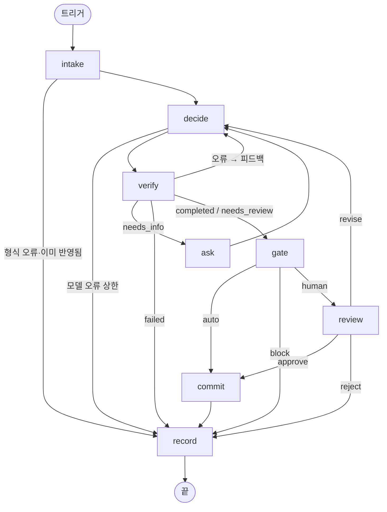

# Hands-on AX 공통 골격(axcore) 사용 가이드

책 14장의 공통 골격을 직접 실행해 보고, 그 위에 내 업무 실습을 만들어 보려는 독자를 위한 문서예요. 공통 골격이 무엇을 해 주는지, 실습을 만들 때 무엇을 채우면 되는지, 템플릿(비품 신청 확인)이 그것을 어떻게 채웠는지 차례로 설명해요.

## 1. 한 문장 요약

**노드는 고치지 않고, 함수 일곱 개만 채워서 넘긴다.**

골격은 두 층으로 나뉘어요.

| 층 | 누가 | 무엇을 |
|---|---|---|
| 위층: 교체 지점 7개 (`JobSpec`) | 실습(job)마다 따로 | 입력 로더, 도구, 지침, 결과 형식, 검증기, 승인 정책, 반영 어댑터 |
| 아래층: 골격 (`axcore`) | 모든 장이 공유 | 실행 흐름(8개 노드), 중단·재개, 중복 반영 방지, 평가 연결 |

실습 하나를 조립하는 코드는 이게 전부예요.

```python
spec = JobSpec(name="supply_request", decision_model=SupplyDecision,
               load_input=load_input, decide=decide,            # ① ②③④
               verify=verify, approval_policy=approval_policy,  # ⑤ ⑥
               commit=commit)                                   # ⑦
graph = build_graph(spec)          # graph.py는 손대지 않음
out = start(graph, Trigger(request_id="TP-001", payload={...}))
```

## 2. 실행 흐름: 8개 노드



| 노드 | 하는 일 | 부르는 교체 지점 |
|---|---|---|
| `intake` | 요청 ID를 정하고, 이미 반영된 요청인지 확인한 뒤 업무 입력을 만들어요. 형식 오류는 LLM까지 가지 않아요. | ① 입력 로더 |
| `decide` | 판단 함수를 불러요. 입력에 재질문 답변과 피드백을 붙여서 넘겨요. | ②③④ (`agent_decider`로 묶음) |
| `verify` | 골격 기본 규칙과 직무 검증기로 검사해요. 오류면 피드백을 붙여 다시 판단, 통과하면 판단 상태로 분기해요. | ⑤ 검증기 |
| `ask` | 실행을 멈추고 부족한 정보를 물어요(`clarify`). | 없음 |
| `gate` | 결과를 자동 반영할지, 사람에게 보낼지, 막을지 정해요. | ⑥ 승인 정책 |
| `review` | 실행을 멈추고 사람의 승인·반려·수정 요청을 받아요(`approval`). | 없음 |
| `commit` | 같은 요청 ID로는 딱 한 번만 반영해요. | ⑦ 반영 어댑터 |
| `record` | 최종 결과를 기록하고 끝내요. | 없음 |

모든 노드는 상태에 `route`를 적고, 그래프는 이 값을 읽는 함수 하나로 모든 분기를 처리해요.

## 3. 판단 상태와 최종 결과

- **판단 상태 `status`(LLM이 제안):** `completed` 처리 가능 / `needs_info` 정보 부족 / `needs_review` 사람 확인 필요 / `failed` 처리 불가
- **최종 결과 `outcome`(골격이 확정):** `committed` 반영됨 / `done` 반영 어댑터 없음 / `rejected` 반려 / `blocked` 차단 / `failed` 실패 / `duplicate` 이미 반영된 요청

## 4. 골격이 보장하는 규칙

실습 코드에서 따로 구현하지 않아도 모든 장에 똑같이 적용돼요.

1. **검토 필요는 자동 반영하지 않아요.** `needs_review`면 승인 정책이 `auto`를 골라도 사람 승인으로 올려요.
2. **근거 없는 결론은 통과하지 못해요.** `completed`·`needs_review`인데 `evidence`가 비어 있으면 검증 실패예요. 근거를 결과 형식 안에서 따로 검증하는 직무는 `require_evidence=False`로 끌 수 있어요.
3. **검증 오류와 수정 요청은 피드백으로 돌아가요.** 다음 판단에 "이전 판단에 대한 피드백"으로 전달돼요.
4. **재시도 예산은 모델의 실수에만 써요.** 검증 실패와 판단 단계 예외만 `model_errors`로 세고, 한 단계에서 `max_model_errors`(기본 3회)에 이르면 실패예요. 검증을 통과해 다음 노드로 넘어가면 0으로 초기화돼요. 재질문 뒤의 재판단과 검토자의 수정 요청은 세지 않아요. 전체 누적은 `model_errors_total`에 남아요.
5. **질문은 `max_questions`(기본 2회)까지만 해요.** 수정 요청은 사람이 통제하는 흐름이라 상한이 없어요.
6. **중단은 두 종류예요.** `clarify`의 답은 문자열, `approval`의 답은 `{"action": "approve" | "reject" | "revise", "reviewer": ..., "comment": ...}`이에요. 형식이 틀리면 다시 물어요.
7. **같은 요청은 한 번만 반영돼요.** `request_id`가 없으면 트리거 내용으로 결정적 ID를 만들어요. 같은 이벤트가 다시 들어오면 `duplicate`로 끝나요.
8. **입력은 요청·이벤트·배치 모두 같은 입구로 받아요.** `Trigger(kind="request" | "event" | "batch", payload=...)`.

## 5. 새 실습을 만드는 순서

`jobs/_template/`을 복사해서 시작하고, 파일 안의 `TODO(새 실습)` 주석을 따라 바꿔요. 모델을 붙이는 일이 맨 마지막이라는 점이 핵심이에요.

1. **업무를 한 문장으로 정의해요.** 무엇을 입력받아, AI가 무엇을 판단하고, 결과를 어디에 반영하는지 써요.
2. **④ 결과 형식부터 정해요.** `AXDecision`을 상속해서 업무에 필요한 필드를 더해요. 판단의 근거 위치(신청서 필드 이름, 원본의 줄 번호 같은 것)를 필드로 넣는 게 핵심이에요. 이게 있어야 ⑤에서 검증할 수 있어요.
3. **⑤ 검증기:** "AI가 적은 값이 원본에 실제로 있는가"를 코드로 확인해요. 확인에 쓰는 키는 모델이 적은 값이 아니라 원본에서 코드가 뽑아요. 오류 메시지에는 원본 값을 함께 적어요.
4. **① 입력 로더:** 규칙으로 할 수 있는 일(형식 검사, 문서 전처리)은 여기서 코드로 끝내요.
5. **가짜 판단기와 평가 사례(`eval_cases.py`)로 흐름을 먼저 돌려요.** 모든 경로가 나오는지 `pytest`로 확인해요.
6. **⑥ 승인 정책과 ⑦ 반영 어댑터:** `auto` / `human` / `block` 기준을 정하고, 반영은 로컬 파일에 기록해요.
7. **② 도구와 ③ 지침:** 조회만 하는 도구와 판단 기준을 써요. 그다음 `live_check.py --jobs <job> --repeat 3`으로 실제 모델을 돌려요.

## 6. 템플릿: 비품 신청 확인 (`jobs/_template/`)

Z몰 총무팀이 비품 신청서를 확인하는 업무예요. 교체 지점 7개를 가장 작게 채운 실행 가능한 예라, 새 실습은 이 폴더를 복사해서 시작해요.

### 시연 시나리오 (`python -m jobs._template.run`)

| 요청 | 신청 | 흐름 | 결과 |
|---|---|---|---|
| TP-001 | 볼펜 5개, 사유 있음 | 10만 원 이하 → 자동 반영 | committed |
| TP-002 | 모니터 1대, 사유 없음 | 사유 질문 → 답변 → 사람 승인 | committed |
| TP-003 | A4 용지 20박스 | 수량 10개 초과 → 검토 필요 → 반려 | rejected |
| TP-004 | 백화점 상품권 | 비품이 아닌 품목 → 차단 | blocked |
| TP-005 | 수량 0 | 입력 로더가 끊음(LLM 호출 없음) | failed |

### 교체 지점별 구현 (`jobs/_template/spec.py`)

| 교체 지점 | 구현 |
|---|---|
| ① 입력 로더 | 품목이 없거나 수량·단가가 0 이하이면 LLM 전에 실패해요. |
| ② 도구 | `lookup_policy`(규칙 원문) |
| ③ 지침 | 금액은 수량 × 단가, 근거는 신청서 필드 이름으로 적을 것, 사유가 없으면 되물을 것 |
| ④ 결과 형식 | `SupplyDecision`: 금액, 사유, 적용한 규칙 ID |
| ⑤ 검증기 | 인용한 필드가 신청서에 있는지, 인용이 원문과 같은지, 금액이 수량 × 단가와 같은지, 사유 없이 completed로 하지 않았는지 |
| ⑥ 승인 정책 | 상품권·주류 → `block` / completed이고 10만 원 이하 → `auto` / 나머지 → `human` |
| ⑦ 반영 어댑터 | 로컬 신청 대장(`register.json`)에 등록 |

## 7. 실습을 만들 때 기억할 것

- **근거 위치를 결과 형식에 넣어요.** 신청서 필드 이름이나 원본의 줄 번호처럼 검증기가 원본에서 찾아갈 수 있는 위치가 있어야 ⑤에서 확인할 수 있어요.
- **"없다"는 판단도 검증해요.** AI가 "없음·누락"이라고 하면 코드가 원본에 정말 없는지 확인해요.
- **승인 정책은 상수여도 돼요.** 자동 반영이 맞지 않는 업무는 `return "human"` 한 줄이면 돼요.
- **중복에는 두 종류가 있어요.** 같은 요청이 두 번 들어오는 건 골격의 요청 ID가 막아요(`duplicate`). 같은 건이 다른 요청으로 다시 들어오는 건 업무 규칙이라 ⑤ 검증기와 도구가 막아요.

## 8. 공용 도구: OCR 어댑터 (`axtools/ocr.py`)

이미지 입력을 쓰는 실습이 함께 쓰는 도구라 골격 코어가 아닌 `axtools`에 뒀어요.

- `TesseractOCR`: 로컬 Tesseract(한국어). 한글이 음절 단위로 쪼개져 나오는 걸 글자 간격으로 다시 이어 붙여요.
- `CachedOCR`: 이미지 옆의 `이미지이름.ocr.json`을 먼저 읽어요. 책의 실행 결과를 고정하고, Tesseract가 없는 독자도 같은 결과로 실습할 수 있게 해요.
- 엔진 바꾸기: `name`과 `read(path) -> OCRResult`만 구현하면 클라우드 OCR로도 바꿀 수 있어요.

## 9. 실행 방법

```bash
pip install -r requirements.txt
# 실제 OCR까지 돌리려면(선택): apt install tesseract-ocr tesseract-ocr-kor

python -m pytest -q                     # 테스트 36개 (골격 잠금 확인 포함)
python -m jobs._template.run            # 새 실습 템플릿(비품 신청) 시연 (가짜 판단기, API 키 불필요)
python -m jobs._template.run --live     # 실제 LLM (기본 모델: jobs/__init__.py의 DEFAULT_MODEL, API 키 필요)
cd .. && python live_check.py --repeat 3  # 모든 job의 평가 사례를 실제 모델로 (.env 키 필요)
cd .. && python live_check.py --fake      # API 없이 같은 사례를 가짜 판단기로
```

## 10. 하지 말 것

- **골격은 최대한 그대로 써요.** 노드 이름, 처리 상태, `outcome` 값, 평가 필드 이름은 다른 장의 코드와 책 14장 설명이 기대므로 바꾸지 않아요. 골격을 일부러 고쳤다면 `tests/test_axcore_locked.py`가 실패하니 `python -m tools.update_lock`으로 잠금 파일을 갱신해요.
- **가짜 판단기 결과를 성능으로 쓰지 않아요.** 흐름 확인용 대역일 뿐이에요. 성공률·시간·비용은 실제 모델로 측정한 값만 써요.
- **실습에서 실제 외부 시스템에 반영하지 않아요.** 지급, 발송, 서명, 댓글 게시는 로컬 기록으로 대신해요.
- **검증을 지침으로 대신하지 않아요.** "금액을 정확히 적어라"는 지침이 아니라 ⑤ 검증기의 일이에요.

## 11. 검증 상태와 한계

- **검증함:** 테스트 36개 통과(골격 22개, OCR 4개, 재시작 재개 1개, 템플릿 6개, 모든 job 평가 사례 2개, 골격 잠금 1개). 테스트 안에서 만든 이미지를 실제 Tesseract 한국어 OCR로 읽었고, `create_agent` 연결은 가짜 채팅 모델로 도구 호출부터 구조화 출력까지 확인했어요.
- **재시작 재개:** SQLite 체크포인터(`SqliteSaver`)로 프로세스를 네 번 새로 띄우며 확인했어요. 템플릿 job의 사유 질문에서 멈춘 실행이 다음 프로세스에서 이어지고, 승인 후 반영되며, 같은 요청을 다시 넣으면 `duplicate`로 끝나요(`tests/test_restart.py`, `langgraph-checkpoint-sqlite` 필요).
- **실제 LLM:** `openai:gpt-6-luna`로 템플릿의 평가 사례 5건을 3회 돌려 15/15건이 기대 경로와 같았어요. 실행은 압축본 최상위의 `live_check.py`(윈도우는 `run_live.bat` 더블클릭)로 하고 결과는 `live_report.md`에 남아요. temperature를 0으로 두어도 실행마다 결과가 조금씩 다르므로 평가 사례는 여러 번 돌려 보세요. 추론 기능이 있는 모델은 `jobs/__init__.py`의 `without_reasoning()`을 거쳐 각 job의 `make_graph()`에 넘어가요.
- **아직 안 함:** 여러 모델 사이의 비교, 서버형 체크포인터(PostgresSaver 등), 이미지를 LLM에 직접 넣는 멀티모달 방식.
- **알려진 한계:** 반영 직후 대장에 기록하기 전에 프로세스가 죽으면 중복 가능성이 남아요. 실제 외부 시스템에는 요청 ID를 중복 방지 키로 함께 넘겨야 해요.
- **알려진 한계:** 검증기 `verify(decision, job_input)`는 되물어 받은 답을 받지 않아요. 되물은 값은 판단 결과 필드에 옮겨 적게 하고 그 필드를 검증하므로, 답에 그 값이 실제로 있었는지는 확인하지 못해요.
- **알려진 한계:** API 호출 실패(인증 오류, 모델 종료, 네트워크 오류)도 지금은 모델 오류로 세어 3회면 실패로 끝나요.
- 버전: `langgraph 1.2.11`, `langchain 1.4.2`, `langchain-core 1.6.3`, `pydantic 2.13.5`.

## 12. 폴더 구조

```
axcore/          공통 골격 (모든 장이 공유, 그대로 쓰는 것을 권장)
  contracts.py   트리거, 근거, 판단 결과, JobSpec(교체 지점 7개)
  graph.py       8개 노드 실행 그래프, start / resume / pending
  ledger.py      요청 ID 기반 반영 대장
  llm.py         agent_decider: 도구·지침·결과 형식을 LangChain 에이전트로 묶음
  evaluate.py    평가 사례 실행, 결과 정규화·채점
axtools/ocr.py   공용 OCR 어댑터 (Tesseract, 캐시)
jobs/__init__.py DEFAULT_MODEL, job 자동 탐색(job_names, load_eval)
jobs/_template/  새 실습의 출발점(비품 신청 확인): spec.py, policies.py, fake_decider.py, eval_cases.py, run.py
jobs/<job>/      직접 만드는 실습 job
tools/           update_lock.py (골격을 고친 뒤 잠금 파일 갱신)
docs/            GUIDE.md(이 문서)
samples/<job>/   실습 장 job의 합성 데이터와 생성 스크립트 (뼈대에는 비어 있음)
tests/           골격·OCR·템플릿·평가 사례·잠금·재시작 테스트
```
